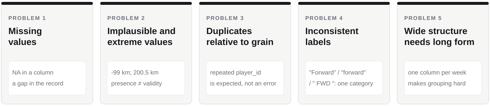
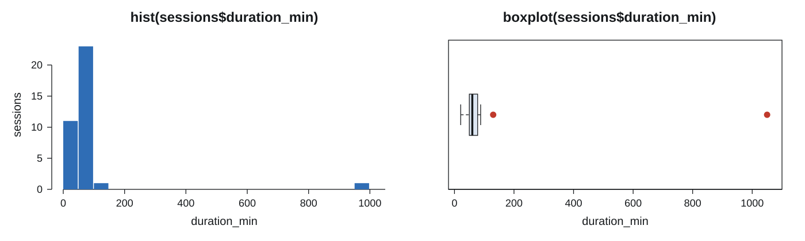
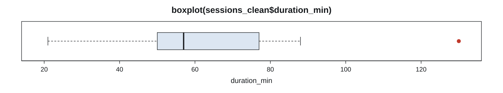

## Our six-week analytical journey

{width="100%"}

Today:

# CLEAN

------------------------------------------------------------------------

## PART ONE

# Introduction

------------------------------------------------------------------------

## Set up your workspace

1.  **Download** the Week 4 project (`week_four_r_project.zip`)
2.  **Decompress** it (Extract All on Windows; double-click on a Mac)
3.  **Open** `week_four.Rproj` in RStudio
4.  Check that the Files pane shows the `data` folder
5.  **Create a new script**: File \> New File \> R Script, and save it
6.  Type the commands as we go, and add your own comments (lines starting with `#`)

The demonstration uses its own table, `week04_demo_sessions.csv`. Your task sheet uses different data, so you will need to adapt what you see today.

------------------------------------------------------------------------

## Where Week 3 left us

Last week, checks turned up results that ran without any error message and still deserved a second look:

-   a position with an unexpectedly high sprint rate;
-   a date filter that quietly kept the wrong matches.

We were **identifying concerns**.

> **Today asks how to intervene, and how to show that the intervention was justified.**

------------------------------------------------------------------------

## Central question

# What is genuinely wrong, and what change is defensible?

::: why
**Cleaning changes evidence.**
:::

> Every deletion, replacement and recoding decision can affect the result.

------------------------------------------------------------------------

## Consequence problem

An analyst replaces every missing GPS value with the squad mean.

There are now no missing values.

### Is the dataset necessarily better?

------------------------------------------------------------------------

## Our cleaning workflow

> **DIAGNOSE → DECIDE → CLEAN → VERIFY**

Do not begin with a cleaning pipeline.

Begin by identifying what the problem actually is.

------------------------------------------------------------------------

## Five recurring problems

{.nostretch fig-align="center" width="100%"}

We will diagnose each of these today. The fixes come after the evidence.

------------------------------------------------------------------------

## Today's demonstration table

Strathclyde FC **training sessions**.

**One row = one training session**, identified by `session_id`.

| Column | Meaning |
|------------------|------------------------------------------------|
| `session_id` | identifies the session |
| `player_id` | who took part |
| `session_type` | pitch, gym or recovery |
| `duration_min` | length of the session in minutes |
| `rpe` | rating of perceived exertion, on a 1 to 10 scale |

A repeated `player_id` is expected: players attend many sessions.

------------------------------------------------------------------------

## PART ONE (continued)

# DIAGNOSE

------------------------------------------------------------------------

## Diagnose 1: look before you touch

``` r
library(tidyverse)

# trim_ws = FALSE keeps surrounding spaces visible, so we can diagnose them
sessions <- read_csv("data/week04_demo_sessions.csv", trim_ws = FALSE)

glimpse(sessions)
nrow(sessions)                  # 37
```

Nothing has been changed yet.

Every later check will be compared with these starting numbers.

------------------------------------------------------------------------

## Diagnose 2: missing and implausible are not the same

``` r
sum(is.na(sessions$duration_min))          # 1
sum(is.na(sessions$rpe))                   # 3

range(sessions$duration_min, na.rm = TRUE) # 21 1050
range(sessions$rpe, na.rm = TRUE)          # 1 99
```

**Missing** means no value is recorded.

`rpe = 99` is recorded, but the scale runs from 1 to 10, so 99 may be a code for "not recorded".

`duration_min = 1050` is present, but is 17.5 hours of training.

> **Presence is not proof of validity.**

------------------------------------------------------------------------

## Diagnose 2: ask before you act

For each unusual value, ask:

-   could this value be real?
-   is it a known sentinel?
-   can it be corrected from the source?
-   should it be represented as missing while we investigate?

Recorded values and missing values are different problems, and they need different questions.

------------------------------------------------------------------------

## Why is the value missing?

The reason matters, because it affects what we can safely do.

-   a sensor failed to record;
-   a value was never collected;
-   the player did not take part;
-   the value was recorded and later lost.

A missing value is not automatically wrong, and there is no single fix that is right for all of them.

> **Find out why before deciding what to do.**

------------------------------------------------------------------------

## Diagnose 3: duplicates depend on grain

In this table:

**one row = one session**

So a repeated `player_id` is expected.

An entire row repeated, including the same `session_id`, may not be.

``` r
sum(duplicated(sessions))       # 1
```

Which row is it, and how would we decide that it is a genuine duplicate?

------------------------------------------------------------------------

## Diagnose 4: inconsistent labels split one category into several

``` r
table(sessions$session_type)
```

```
   Pitch      GYM      Gym    PITCH    Pitch      Rec Recovery     gym     pitch recovery
       1        1        9        1       15        2        5        1        1        1
```

Three kinds of session. **Ten** labels.

Anything we group by `session_type` would produce ten groups.

------------------------------------------------------------------------

## PART ONE (continued)

# FLAG

------------------------------------------------------------------------

## Can R help us find the candidates?

Checking one column by eye works when there are 37 rows.

Real tracking data has many columns and many thousands of rows.

We can ask R to **flag** candidates, using a rule, in a new column.

> **A flag marks a row for review. It does not change the data.**

------------------------------------------------------------------------

## Two kinds of rule

**A domain rule**: impossible by definition.

-   `rpe` outside 1 to 10
-   `duration_min` of more than 180 minutes, for a club that never trains for three hours

**A statistical rule**: unusual compared with the rest of the column.

-   outside the **IQR fences**: below Q1 minus 1.5 × IQR, or above Q3 plus 1.5 × IQR
-   a **z-score** beyond 3 in either direction

The thresholds are conventions, not laws.

------------------------------------------------------------------------

## Flagging with familiar functions

``` r
lower <- quantile(sessions$duration_min, 0.25, na.rm = TRUE) -
  1.5 * IQR(sessions$duration_min, na.rm = TRUE)
upper <- quantile(sessions$duration_min, 0.75, na.rm = TRUE) +
  1.5 * IQR(sessions$duration_min, na.rm = TRUE)

flagged <- sessions |>
  mutate(
    iqr_flag = duration_min < lower | duration_min > upper,
    z = (duration_min - mean(duration_min, na.rm = TRUE)) /
      sd(duration_min, na.rm = TRUE),
    z_flag = abs(z) > 3
  )
```

`mutate()` adds columns. `quantile()`, `IQR()`, `mean()` and `sd()` are functions we already know.

------------------------------------------------------------------------

## Predict before we run it: flags

We are about to run the IQR rule and the z-score rule on `duration_min`.

1.  Which sessions will the **IQR rule** flag?
2.  Which will the **z-score rule** flag?
3.  Will the two rules agree?

Write your prediction as a comment in your script.

::: notes
Answer: IQR flags S012 (1050) and S035 (130). z-score flags S012 only. The 1050 inflates the standard deviation to about 167, so S035 has z of about 0.25.
:::

------------------------------------------------------------------------

## Flag, then look

``` r
flagged |>
  filter(iqr_flag | z_flag) |>
  select(session_id, session_type, duration_min, iqr_flag, z_flag)
```

| session_id | session_type | duration_min | iqr_flag | z_flag |
|------------|--------------|-------------:|----------|--------|
| S012       | Gym          |         1050 | TRUE     | TRUE   |
| S035       | Pitch        |          130 | TRUE     | FALSE  |

The two rules disagree about S035.

The 1050 inflates the standard deviation to about 167 minutes, so the 130 has a z-score of only about 0.25.

> **A statistical rule can miss a value, or flag one that is perfectly legitimate.**

------------------------------------------------------------------------

## Look at it: a picture shows what a table hides

``` r
hist(sessions$duration_min)
boxplot(sessions$duration_min, horizontal = TRUE)
```

{.nostretch fig-align="center" width="82%"}

The histogram shows one session far to the right of all the others. The boxplot draws the IQR rule: the 1050 and the 130 both fall beyond the whiskers.

A picture shows how far a value sits from the rest. It does not tell us whether the value is wrong.

::: notes
These are quick inspection plots, not presentation graphics; polished charts come later in the module. The red points in the boxplot are exactly the two sessions the IQR rule flagged (S012 and S035). The z-score rule missed S035; the picture makes the disagreement easy to see.
:::

------------------------------------------------------------------------

## Three kinds of odd value, three responses

| What the value turns out to be | Example | Sensible response |
|----------------------|---------------------|-------------------------------|
| **Impossible** | `duration_min = 1050`; `rpe = 99` | set to `NA`; record the rule |
| **Unusual but plausible** | `duration_min = 130`, if the coach confirms an extended match simulation | keep it; keep the flag; say so |
| **Unknown** | an extreme value nobody can explain | investigate the source before changing anything |

We cannot tell which kind S035 is from the numbers alone.

> **Automation produces the candidates. The analyst makes the decision.**

------------------------------------------------------------------------

## PART ONE (continued)

# DECIDE, then CLEAN

------------------------------------------------------------------------

## One defensible intervention

For clearly impossible values:

``` r
sessions_clean <- sessions |>
  mutate(
    duration_min = if_else(duration_min > 180, NA_real_, duration_min),
    rpe = if_else(rpe < 1 | rpe > 10, NA_real_, rpe)
  )
```

The thresholds need a contextual justification.

We are not inventing a replacement value: we record that the value cannot be trusted.

The 130-minute session is **not** changed.

------------------------------------------------------------------------

## Labels: trim, standardise case, then map

Trimming and case standardisation help:

``` r
str_trim()
str_to_lower()
```

But they do not turn `rec` into `recovery`.

After trimming and lowering case, abbreviations need an explicit mapping:

``` r
case_when(
  session_type == "rec" ~ "recovery",
  TRUE ~ session_type
)
```

This is a recoding decision. You should be able to explain why the labels are equivalent.

------------------------------------------------------------------------

## Duplicates: remove only what the grain supports

``` r
distinct()
```

Our grain is one row per session, so an entire repeated row adds no new information.

Before and after:

``` r
nrow(sessions)                  # 37
```

Which row would you expect to disappear?

------------------------------------------------------------------------

## Missing values: three possible responses

| Response | What it does | What it costs |
|------------------|--------------------------|-------------------------------|
| **Leave as `NA`** | keep the row; the calculation says how to treat `NA` (`na.rm = TRUE`) | each mean rests on fewer values |
| **Drop the row** | `na.omit()` or `drop_na()` | removes every other value in the row too |
| **Impute** | replace `NA` with a stand-in, such as a median | adds a value that was never observed |

On our cleaned table, `na.omit()` would leave **29 of 36** rows, to remove **7** missing values.

> **None of these is neutral. The question decides which is defensible.**

------------------------------------------------------------------------

## One cleaning pipeline

``` r
sessions_clean <- sessions |>
  mutate(
    duration_min = if_else(duration_min > 180, NA_real_, duration_min),
    rpe = if_else(rpe < 1 | rpe > 10, NA_real_, rpe),
    session_type = str_to_lower(str_trim(session_type)),
    session_type = case_when(
      session_type == "rec" ~ "recovery",
      TRUE ~ session_type
    )
  ) |>
  distinct()
```

Each line exists because of a decision we can explain.

------------------------------------------------------------------------

## PART ONE (continued)

# VERIFY

------------------------------------------------------------------------

## Verify after cleaning

Re-run the checks that revealed the problem, and compare with the starting numbers:

``` r
nrow(sessions_clean)                                   # 36
sum(is.na(sessions_clean$duration_min))                # 2
sum(is.na(sessions_clean$rpe))                         # 5
range(sessions_clean$duration_min, na.rm = TRUE)       # 21 130
range(sessions_clean$rpe, na.rm = TRUE)                # 1 8
table(sessions_clean$session_type)                     # gym 10, pitch 18, recovery 8
sum(duplicated(sessions_clean))                        # 0
```

Missing values went **up** (1 to 2, and 3 to 5): that is what we intended.

The maximum is now 130, because we chose to keep that session.

------------------------------------------------------------------------

## Predict before we run it: the boxplot after cleaning

We have set the 1050 to `NA`. The 130 is still in the data.

1.  How will the scale of the boxplot change?
2.  How many points will the boxplot mark as outliers?

Write your prediction as a comment in your script.

::: notes
Answer: the axis now runs to about 130 rather than 1050, so the box and whiskers are readable. One point is still marked: the 130, which we chose to keep. Cleaning removed the impossible value, not the unusual one.
:::

------------------------------------------------------------------------

## The same boxplot, after cleaning

``` r
boxplot(sessions_clean$duration_min, horizontal = TRUE)
```

{.nostretch fig-align="center" width="82%"}

The 130 is still marked. It is a plausible value that we kept, and the flag still records it.

> **Plotting before and after is a check on the cleaning, as well as on the data.**

------------------------------------------------------------------------

## Predict before we run it: group means

We have cleaned the labels, set the impossible values to `NA`, and removed the duplicate.

Before cleaning, the `Gym` group had a mean duration of **162.6** minutes.

What do you expect the mean duration of gym sessions to be afterwards?

Write your prediction as a comment in your script.

::: notes
Answer: gym 51.9 (n = 10), after merging Gym, GYM, gym and 'gym ' and removing the 1050. Pitch 79.9 (n = 18), recovery 23.4 (n = 8).
:::

------------------------------------------------------------------------

## Does cleaning change the answer?

``` r
sessions |>
  group_by(session_type) |>
  summarise(mean_duration = mean(duration_min, na.rm = TRUE), n = n())
```

Before cleaning: **ten** groups. The `Gym` group had a mean of **162.6** minutes (9 sessions).

After cleaning:

| session_type | mean_duration | n  |
|--------------|--------------:|---:|
| gym          | 51.9          | 10 |
| pitch        | 79.9          | 18 |
| recovery     | 23.4          | 8  |

> **The same code gave a different conclusion because the data changed.**

------------------------------------------------------------------------

## A value we keep still needs handling

If the 130-minute session is plausible, it is still extreme. What do we do with it?

| Option | What it does | Cost |
|---------------|------------------------------|--------------------------|
| **Report both ways** | result with and without the value | two answers to explain |
| **Robust summary** | report the median, which barely moves | says less about extremes |
| **Winsorise** | pull extremes in to a percentile | alters real observations |
| **Transform** | analyse on another scale, e.g. log | harder to interpret |

``` r
x <- sessions_clean$duration_min
mean(x, na.rm = TRUE);        median(x, na.rm = TRUE)         # 60.6  57
mean(x[x != 130], na.rm = TRUE);  median(x[x != 130], na.rm = TRUE)   # 58.5  55.5
```

In the raw data, the 1050 moved the mean from 60.6 to 88.1 but the median only from 57 to 60.

> **Whichever we choose, we say so, and show the conclusion survives.**

::: notes
Link back to the three kinds of odd value. Once a value is classed as plausible, the choice is about how to summarise, not whether to delete. The raw figures (88.1 mean, 60 median) include the 1050 value. Winsorising and transforming are named so students recognise them; we do not practise them today.
:::

------------------------------------------------------------------------

## PART ONE (continued)

# Missing values that remain

------------------------------------------------------------------------

## What is still missing, and what do we need?

After cleaning, `sessions_clean` has:

-   **2** missing `duration_min` values (S012, the 1050 we set to `NA`, and S020);
-   **5** missing `rpe` values.

Suppose the question is: **what is the mean session length for each type of session?**

Do we need a value for every session to answer it?

For this question, `mean(..., na.rm = TRUE)` already works. Imputing is a choice we make, not something R requires.

::: notes
Let students argue: leaving NA is a valid answer here. Imputation is justified only when something downstream needs a complete column (for example a model, or a total across sessions).
:::

------------------------------------------------------------------------

## Predict before we run it: imputation

Replace the 2 missing durations with the **overall mean** duration (about 61 minutes).

1.  What happens to the mean for **recovery** sessions?
2.  What happens to the mean for **pitch** sessions?
3.  Why?

Write your prediction as a comment in your script.

::: notes
Answer: overall mean imputation moves recovery from 23.4 to 28.1 (S020 is a recovery session given 61 minutes). Pitch is unchanged at 79.9 because no pitch duration was missing. A single overall value ignores the groups.
:::

------------------------------------------------------------------------

## Imputation in R: replace, and mark what you replaced

``` r
m <- mean(sessions_clean$duration_min, na.rm = TRUE)

sessions_clean |>
  mutate(duration_min = replace_na(duration_min, m))
```

A better stand-in uses the group the row belongs to, and records what was imputed:

``` r
sessions_imputed <- sessions_clean |>
  group_by(session_type) |>
  mutate(
    duration_imputed = is.na(duration_min),
    duration_min = if_else(
      is.na(duration_min),
      median(duration_min, na.rm = TRUE),
      duration_min
    )
  ) |>
  ungroup()
```

`duration_imputed` is a new column: `TRUE` where we filled the value in.

------------------------------------------------------------------------

## What did imputation change?

| session_type | leave `NA` | overall mean | median of own type |
|--------------|-----------:|-------------:|-------------------:|
| gym          | 51.9       | 52.8         | 51.9               |
| pitch        | 79.9       | 79.9         | 79.9               |
| recovery     | 23.4       | 28.1         | 23.2               |

-   The overall mean pulls recovery towards the other groups.
-   Using the median of the row's own type keeps the groups apart.
-   Every imputed value is a guess. S012 and S020 now look like ordinary sessions, and because each sits exactly at the centre of its type, the spread within gym and recovery sessions is slightly smaller (gym 3.1 to 3.0, recovery 2.9 to 2.7).

> **Imputing replaces missing evidence with an assumption. State the assumption.**

------------------------------------------------------------------------

## Decide variable by variable

| Variable | Missing | Impute? | Reason |
|-----------------|--------------|--------------|------------------------------|
| `duration_min` | 2 of 36 | possible | few values; a typical value for the session type is a reasonable stand-in |
| `rpe` | 5 of 36 | leave as `NA` | a rating from 1 to 10 should be a whole number; an imputed 5.1 is not a possible rating, and 5 of 36 is a lot to invent |

Questions to ask before imputing:

-   Does the analysis need a complete column?
-   How much is missing? What would a stand-in mean here?
-   Does the stand-in make sense for this type of variable?
-   Have I marked it, and can I report how many values are imputed?

::: notes
Check the numbers: 2 of 36 durations, 5 of 36 rpe values. Imputation by the mean is the simplest method, not the best. Model-based and multiple imputation exist and are covered in more advanced modules; today the skill is deciding whether to impute, and recording it.
:::

------------------------------------------------------------------------

## Record the decision

Every intervention needs a reason and a check:

| Issue | Decision | Verified by |
|------------------------|-------------------|-------------------------------|
| `duration_min = 1050` | set to `NA` (more than 180) | range now 21 to 130 |
| `rpe = 99` | set to `NA` (outside 1 to 10) | range now 1 to 8 |
| duration of 130 | keep; flagged; plausible | still present, flag recorded |
| ten session labels | trim, lower case, map `rec` | three labels |
| repeated row | `distinct()` | 37 rows to 36 |
| 2 missing durations | impute with median of own session type; mark with `duration_imputed` | 2 rows flagged, group means checked |
| 5 missing `rpe` | leave as `NA` | still 5, reported |

> **If you cannot show what changed, you have not finished cleaning.**

------------------------------------------------------------------------

## A different problem: table structure

Wide:

| player_id | wk_1 | wk_2 | wk_3 | wk_4 |
|-----------|-----:|-----:|-----:|-----:|

Long:

| player_id | week | load_au |
|-----------|------|--------:|

The same observations can be represented in a structure that is easier to group, summarise and plot.

------------------------------------------------------------------------

## Predict before we run it: reshaping

`load_wide` has 6 rows and four week columns: `wk_1` to `wk_4`.

After `pivot_longer()`:

1.  How many rows will `load_long` have?
2.  What will one row represent?

::: notes
Answer: 24 rows (6 players x 4 weeks). One row is one player in one week.
:::

------------------------------------------------------------------------

## `pivot_longer()` changes the grain

``` r
load_wide <- read_csv("data/week04_demo_load_wide.csv")

load_long <- load_wide |>
  pivot_longer(
    cols = starts_with("wk_"),
    names_to = "week",
    values_to = "load_au"
  )

nrow(load_wide)                 # 6
nrow(load_long)                 # 24
```

After reshaping, ask again:

> **What does one row represent?**

Before: one player. After: one player in one week.

------------------------------------------------------------------------

## PART TWO

# Open the Week Four Task Sheet

------------------------------------------------------------------------

## Work through, in order

-   **CORE**: first revisit Weeks 1 to 3 on the tracking table; then diagnose, flag, decide, clean and verify the messy tracking extract, including what to do about missing values; then reshape a wide file
-   **AUDIT**: judge a colleague's cleaning script
-   **TRANSFER**: rugby wellness decision table
-   **EXTENSION**: how much the missing values could matter, a reusable flagging function, and a decision log for ambiguous values, if time allows

Keep your demonstration script open. Most tasks start from a block of it.

Use the hint sheet if you get stuck.

**Slides are paused until we regroup.**

------------------------------------------------------------------------

## PART THREE

# Regroup: whole-group debrief

------------------------------------------------------------------------

## What did your flags reveal?

On the tracking extract:

-   the IQR rule flagged **every** impossible distance;
-   a z-score rule flagged the 200.5 km value (z about 4.5) but **missed** the `-99` values (z about -2.4), because the extreme values inflate the standard deviation.

After cleaning, flagging again raises one new candidate: **4.69 km**, from a 48-minute appearance. That is about 8.8 km per 90 minutes, which is unremarkable.

> **A flag is a prompt to investigate, not a verdict.**

------------------------------------------------------------------------

## Cleaning is part of the analysis

With the sentinels left in, forwards appear to cover the most distance, and midfielders the least.

Once the impossible values become `NA`, the order reverses.

Neither version came with an error message.

Cleaning decisions can change:

-   who remains in the data;
-   group summaries;
-   distributions;
-   later joins;
-   any conclusion built on the cleaned file.

------------------------------------------------------------------------

## So what?

An analyst should be able to explain, and verify, a cleaning decision to somebody who did not write the code.

-   what was wrong, and how did you know?
-   what did you change, and what did you leave alone?
-   how do you know the change did what you intended?
-   what remains uncertain?

> **Cleaning is part of the analysis.**

------------------------------------------------------------------------

## Assessment One connection

Core problems include:

-   missingness and plausibility, including the choice to leave, drop or replace a missing value;
-   duplicates relative to grain;
-   string standardisation and simple recoding;
-   `pivot_longer()` and the resulting grain;
-   verification after cleaning.

Automated flags are a way of applying plausibility checks. The judgement they support is core; the particular thresholds are conventions.

`pivot_wider()` remains extension.

------------------------------------------------------------------------

## End checkpoint

Can you explain a cleaning decision without saying:

> "because the code needed it"?

Next week:

# CONNECT
