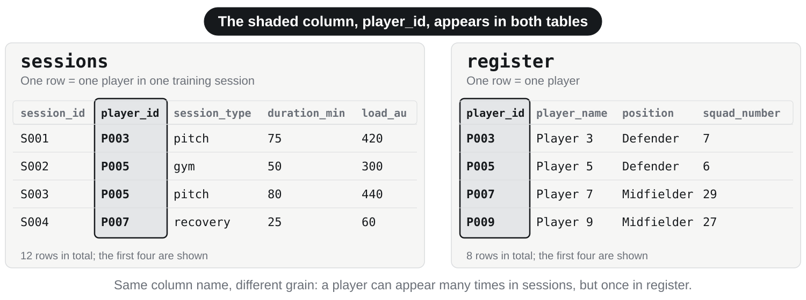
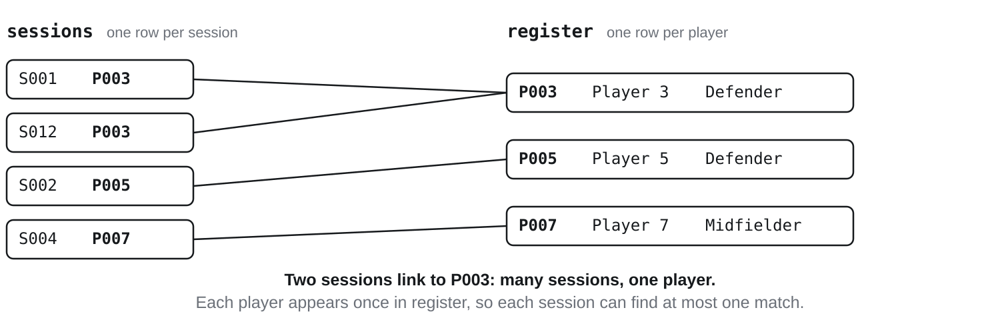
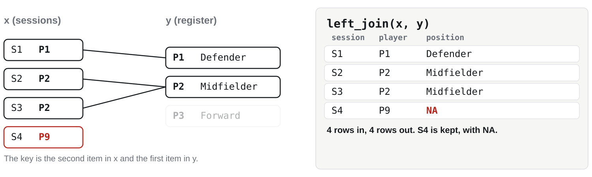
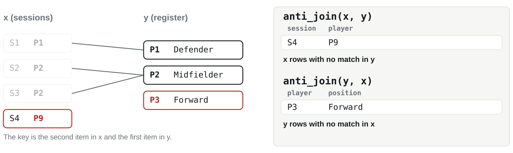
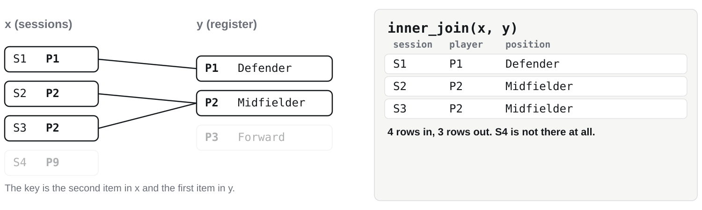
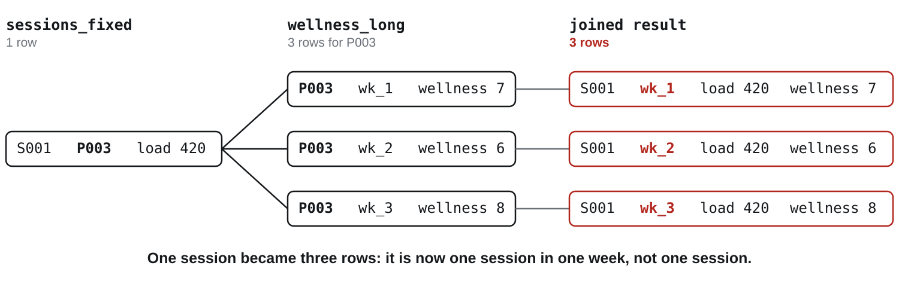
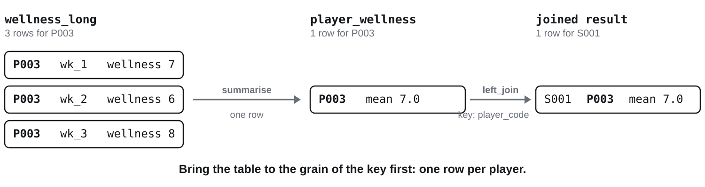

## Our six-week analytical journey

{width="100%"}

------------------------------------------------------------------------

## PART ONE

# Introduction

------------------------------------------------------------------------

## Set up your workspace

1.  **Download** the Week 5 project (`week_five_r_project.zip`)
2.  **Decompress** it (Extract All on Windows; double-click on a Mac)
3.  **Open** `week_five.Rproj` in RStudio (the Files pane should show the `data` folder)
4.  **Create a new script**: File \> New File \> R Script, and save it
5.  Type the commands as we go, and add your own comments (lines starting with `#`)

The demonstration uses its own tables, which begin `week05_demo_`. Your task sheet uses different data, so you will need to adapt what you see today.

------------------------------------------------------------------------

## Where Week 4 left us

Last week we worked on **one table at a time**:

-   we diagnosed missing, implausible, duplicate and inconsistent values;
-   we decided what change was defensible, and verified it.

> **Today the evidence we need is spread across more than one table.**

------------------------------------------------------------------------

## Central question

What if the evidence we need is spread across different tables?

::: why
**Joining changes evidence.**
:::

> A join can keep, lose or multiply observations, and R may not tell you.

------------------------------------------------------------------------

## Consequence problem

An analyst joins a table of training sessions to the squad register.

R gives no error and no warning. The joined table looks tidy.

### Is the joined table necessarily right?

------------------------------------------------------------------------

## Our join workflow

{.nostretch fig-align="center" width="100%"}

Decide what the result should look like **before** you join.

Check that it does look like that **after** you join.

------------------------------------------------------------------------

## Today's demonstration tables

{.nostretch fig-align="center" width="100%"}

`load_au` is training load in arbitrary units. `session_type` is pitch, gym or recovery.

# Revision: Weeks 1 to 4

------------------------------------------------------------------------

## Revision first

Every step of today's join uses something you already know.

On the revision slides that follow, try to write the code **before** it appears.

------------------------------------------------------------------------

## Revision 1: import and inspect

Import both demonstration tables, keeping any spaces around text values, and take a first look.

. . .

``` r
library(tidyverse)

sessions <- read_csv("data/week05_demo_sessions.csv", trim_ws = FALSE)
register <- read_csv("data/week05_demo_register.csv", trim_ws = FALSE)

glimpse(sessions)
nrow(sessions)      # 12
nrow(register)      # 8
```

`trim_ws = FALSE` keeps `"gym "` and `"gym"` visibly different, as in Week 4.

------------------------------------------------------------------------

## Revision 2: the grain of each table

What does one row represent in `sessions`, and in `register`?

Check by counting how often `player_id` is repeated within each table.

. . .

``` r
sum(duplicated(sessions$player_id))     # 4 repeats
sum(duplicated(register$player_id))     # 0 repeats
```

-   `sessions`: one row = one player in one session
-   `register`: one row = one player

> **The same column can play a different role in each table.**

------------------------------------------------------------------------

## Revision 3: numbers that are numbers, and numbers that are labels

`squad_number` is stored as a number, but it labels a player. How do we tell R?

. . .

``` r
class(register$squad_number)                    # "numeric"
mean(register$squad_number)                     # 13.875: calculated, but meaningless

register$squad_number <- as.factor(register$squad_number)

class(register$squad_number)                    # "factor"
mean(register$squad_number)                     # NA, with a warning
```

::: notes
as.factor() is the one new function in the revision. The warning reads: argument is not numeric or logical: returning NA. It is the point of the slide: once the values are labelled as categories, R refuses arithmetic on them.
:::

------------------------------------------------------------------------

## Revision 3: reading the result

| Column | Stored as | The values are | Arithmetic? |
|------------------|------------------|-------------------------|---------------------|
| `duration_min` | numeric | **amounts** | yes |
| `squad_number` | `factor` (was numeric) | **labels** | no |
| `player_id` | character (text) | **labels** | no |

`as.factor()` tells R the values are categories, so R refuses to average them.

> **Identifiers connect tables by exact match, never by arithmetic.**

------------------------------------------------------------------------

## Revision 4: missing and implausible

Check `duration_min` and `load_au` for missing values, then for implausible values.

. . .

``` r
sum(is.na(sessions$duration_min))   # 0
sum(is.na(sessions$load_au))        # 0

range(sessions$duration_min)        # 20 90
range(sessions$load_au)             # 55 500
```

> **Run both checks. Neither one answers the other.**

------------------------------------------------------------------------

## Revision 5: duplicates depend on grain

Has any session been recorded twice?

. . .

``` r
sum(duplicated(sessions))               # 0: no whole row repeated
sum(duplicated(sessions$session_id))    # 0: no session ID repeated
```

A repeated `player_id` is **not** a duplicate. It is what the grain allows.

A repeated `session_id` would be.

------------------------------------------------------------------------

## Revision 6: derive the measure

Sessions differ in length. Create a column for training load **per hour**.

. . .

``` r
sessions <- sessions |>
  mutate(load_per_hour = load_au / duration_min * 60)
```

We keep the new column in `sessions`, because we will need it after the join.

------------------------------------------------------------------------

## Revision 7: summarise by group

Which session type has the highest mean load, and which the highest mean load per hour?

. . .

``` r
sessions |>
  group_by(session_type) |>
  summarise(
    n = n(),
    mean_load = round(mean(load_au)),
    mean_per_hour = round(mean(load_per_hour))
  )
```

------------------------------------------------------------------------

## Revision 7: reading the result

| session_type |   n | mean_load | mean_per_hour |
|--------------|----:|----------:|--------------:|
| gym          |   3 |       303 |           364 |
| pitch        |   6 |       423 |           331 |
| recovery     |   3 |        62 |           150 |

Pitch has the highest mean load. Gym has the highest mean load per hour.

> **The question decides which measure answers it.**

::: notes
Same logic as distance per 90 in Week 3: when exposure differs, a total and a rate answer different questions.
:::

------------------------------------------------------------------------

## Revision 8: do the identifiers connect?

Does every `player_id` in `sessions` appear in `register`?

. . .

``` r
all(sessions$player_id %in% register$player_id)   # FALSE
sum(sessions$player_id %in% register$player_id)   # 10
```

Two of the 12 sessions name a player we cannot find in the register.

`%in%` tells us **how many**. It does not tell us **which**, or **why**.

> **Today's new functions answer both.**

------------------------------------------------------------------------

## What Weeks 1 to 4 give us today

`glimpse()` · `nrow()` · `duplicated()` · `is.na()` · `range()` · `mutate()` · `group_by()` · `summarise()` · `%in%` · `str_trim()` · `pivot_longer()`

You will meet each of these again in the next part.

> **Earlier weeks' checks are how we verify this week's joins.**

------------------------------------------------------------------------

## New this week

# Connecting tables

------------------------------------------------------------------------

## The question

A coach asks:

> **Do defenders and midfielders carry different training load per hour?**

-   `load_per_hour` is in `sessions`
-   `position` is in `register`

No single table can answer the question.

------------------------------------------------------------------------

## A key connects the tables

{.nostretch fig-align="center" width="100%"}

`player_id` names the same player in both tables. A column that does this is a **key**.

------------------------------------------------------------------------

## The key must be unique in the table you join to

For each session we want **one** position.

So each `player_id` may appear only **once** in `register`.

``` r
sum(duplicated(register$player_id))     # 0
```

We already ran this in Revision 2. Each session can find at most one matching player.

::: notes
If P003 appeared twice in the register, each of P003's sessions would be matched twice and the joined table would have more rows than sessions. We return to this later.
:::

------------------------------------------------------------------------

## `left_join()`: what are we asking?

> **Keep every session, and add each session's player details where we can find them.**

`sessions` goes on the **left**: its rows are the observations that must survive.

`register` supplies the information we add.

------------------------------------------------------------------------

## `left_join()` on a small example

{.nostretch fig-align="center" width="100%"}

Every row of `x` is kept. Where the key matches, the columns of `y` are added. Where it does not, they are `NA`.

------------------------------------------------------------------------

## Predict before we run it: the left join

Revision 8 found that 10 of the 12 sessions have a matching player.

1.  How many rows will the joined table have?
2.  How many rows will have a missing `position`?

Write your prediction as a comment in your script.

::: notes
Answer: 12 rows, because a left join keeps every session. 2 missing positions: the two sessions that %in% flagged.
:::

------------------------------------------------------------------------

## `left_join()`: how R answers

``` r
joined <- sessions |>
  left_join(register, by = "player_id")

nrow(joined)                    # 12
sum(is.na(joined$position))     # 2
```

`by =` names the key.

The result has every column of `sessions` and the other columns of `register`.

------------------------------------------------------------------------

## `left_join()`: reading the result

-   **12 rows in, 12 rows out.** One row is still one player in one session.
-   **2 missing positions.** The same two sessions that `%in%` flagged.

> **Verify every join: count the rows, and count the missing joined values.**

------------------------------------------------------------------------

## `anti_join()`: what are we asking?

> **Which rows of the first table found no match in the second?**

It returns the unmatched rows themselves, so we can see **which** they are.

------------------------------------------------------------------------

## `anti_join()` on a small example

{.nostretch fig-align="center" width="100%"}

The two directions ask different questions. The result is the unmatched rows themselves.

------------------------------------------------------------------------

## `anti_join()`: which sessions found no player?

``` r
sessions |>
  anti_join(register, by = "player_id") |>
  select(session_id, player_id)
```

| session_id | player_id |
|------------|-----------|
| S005       | P009      |
| S011       | P031      |

::: notes
P009 looks as though it should have matched. Leave the puzzle open until the diagnosis slide. If R prints the value in quotes ("P009 "), that is the clue: R quotes text with spaces at either end.
:::

------------------------------------------------------------------------

## `anti_join()`: which players have no sessions?

``` r
register |>
  anti_join(sessions, by = "player_id") |>
  select(player_id, position)
```

| player_id | position   |
|-----------|------------|
| P009      | Midfielder |
| P018      | Forward    |

------------------------------------------------------------------------

## `anti_join()`: reading the result

| Unmatched | What it suggests |
|-----------------------|-------------------------------------------------|
| S005, player `P009` | P009 is in the register **and** has a session, yet they did not match |
| S011, player `P031` | a player who is not in the register at all |
| P018, no sessions | a squad player who did not train in this period: possibly legitimate |

> **P009 appears on both sides. That points to a key that is written differently in the two tables.**

------------------------------------------------------------------------

## Diagnose the key

S005 is the fifth row of `sessions`. Look at its `player_id` exactly.

``` r
sessions$player_id[5]           # "P009 "
nchar(sessions$player_id[5])    # 5
```

A trailing space: the same inconsistent-label problem as `"gym "` in Week 4.

> **A key has to match exactly, character for character.**

::: notes
By default read_csv() trims spaces, and S005 would have matched. Other import tools and data sources do not always do this, so we kept the space visible with trim_ws = FALSE.
:::

------------------------------------------------------------------------

## Decide: two unmatched sessions, two decisions

| Session | Problem | Decision |
|----------------|--------------------------------|--------------------------|
| S005 | key written with a trailing space | repair the key with `str_trim()` |
| S011 | player `P031` is not in the register | keep the row, leave `NA`, report it |

> **We can repair a formatting error. We cannot invent a match.**

------------------------------------------------------------------------

## Repair the key, then join again

``` r
sessions_fixed <- sessions |>
  mutate(player_id = str_trim(player_id))

joined_fixed <- sessions_fixed |>
  left_join(register, by = "player_id")

nrow(joined_fixed)                                              # 12
sum(is.na(joined_fixed$position))                               # 1
nrow(anti_join(sessions_fixed, register, by = "player_id"))     # 1
```

12 rows, as before. One unmatched session remains: S011, as we decided.

------------------------------------------------------------------------

## `inner_join()` on a small example

{.nostretch fig-align="center" width="100%"}

Only rows with a match in **both** tables are kept. S4 is not marked as missing: it is simply not there.

------------------------------------------------------------------------

## Predict before we run it: the inner join

After the repair, one session (S011) has no matching player.

How many rows will `inner_join()` return?

Write your prediction as a comment in your script.

::: notes
Answer: 11. S011 is dropped.
:::

------------------------------------------------------------------------

## `inner_join()`: how R answers

``` r
inner <- sessions_fixed |>
  inner_join(register, by = "player_id")

nrow(inner)                     # 11
sum(is.na(inner$position))      # 0
```

S011 has gone. There was no error, no warning, and no `NA` left to count.

------------------------------------------------------------------------

## Choosing the join

|                    | `left_join()`                | `inner_join()`            |
|--------------------|------------------------------|---------------------------|
| keeps              | every row of the left table  | only rows matched in both |
| unmatched rows     | kept, with `NA`              | dropped without a message |

> **Choose the join by asking which observations must survive.**

The coach asked about training sessions, so every session must survive: we use `left_join()`.

------------------------------------------------------------------------

## Answer the coach's question

Group the joined table by position. Count the sessions and find the mean load per hour.

. . .

``` r
joined_fixed |>
  group_by(position) |>
  summarise(
    n = n(),
    mean_per_hour = round(mean(load_per_hour))
  )
```

------------------------------------------------------------------------

## Reading the result

| position   |   n | mean_per_hour |
|------------|----:|--------------:|
| Defender   |   7 |           319 |
| Midfielder |   4 |           242 |
| NA         |   1 |           330 |

-   Defenders averaged **319** units per hour; midfielders **242**
-   The `NA` group is S011. It stays visible, and we report it
-   There is no Forward row: P018, the only forward, had no sessions
-   Four midfielder sessions is a small basis for any claim

------------------------------------------------------------------------

## Does the join change the answer?

|                                | First join | After repairing the key |
|--------------------------------|-----------:|------------------------:|
| unmatched sessions             |          2 |                       1 |
| midfielder sessions            |          3 |                       4 |
| midfielder mean load per hour  |        212 |                 **242** |

> **The first join ran without an error. Its answer was wrong.**

::: notes
With inner_join() on the first attempt, the midfielder mean would also read 212, and there would be no NA group to suggest anything had been lost.
:::

# When a join multiplies rows

------------------------------------------------------------------------

## A third table

The sports science staff record a weekly **wellness score** for each player (1 to 10; higher is better).

| player_code | wk_1 | wk_2 | wk_3 |
|-------------|-----:|-----:|-----:|
| P003        |    7 |    6 |    8 |
| P005        |    5 |    6 |    6 |
| P007        |    8 |   NA |    7 |

[The table has 8 rows, one per player. These are the first three.]{.small}

-   The key is called `player_code` here, not `player_id`
-   Each week is a separate column

------------------------------------------------------------------------

## Revision 9: one row per player per week

Import the table and reshape it so each row is one player in one week. How many rows?

. . .

``` r
wellness <- read_csv("data/week05_demo_wellness.csv")

wellness_long <- wellness |>
  pivot_longer(cols = starts_with("wk_"),
               names_to = "week", values_to = "wellness")

nrow(wellness_long)                     # 24
sum(is.na(wellness_long$wellness))      # 1
```

8 players × 3 weeks = 24 rows: the grain has changed, as in Week 4.

------------------------------------------------------------------------

## When the key has a different name in each table

``` r
by = c("player_id" = "player_code")
```

-   The name in the **left** table comes first
-   The name in the **right** table comes second

The values must still match exactly. Only the column names differ.

------------------------------------------------------------------------

## Predict before we run it: joining the weekly table

`sessions_fixed` has 12 rows. `wellness_long` has 24.

We add `wellness_long` to `sessions_fixed` with a left join.

How many rows will the result have?

Write your prediction as a comment in your script.

::: notes
Answer: 34. Each of the 11 matched sessions finds three rows in wellness_long, one per week: 33 rows. S011 finds none and is kept once: 34.
:::

------------------------------------------------------------------------

## Joining the weekly table: how R answers

``` r
too_many <- sessions_fixed |>
  left_join(wellness_long, by = c("player_id" = "player_code"))

nrow(too_many)      # 34
```

R also prints a warning:

`Detected an unexpected many-to-many relationship between x and y.`

Read warnings. This one says that keys repeat in **both** tables.

::: notes
R warns here only because player IDs repeat on both sides. If the key repeated only in the right-hand table, the rows would multiply in the same way with no warning. The row count is the check that always works.
:::

------------------------------------------------------------------------

## Why 34 rows?

{.nostretch fig-align="center" width="100%"}

P003 appears once in `sessions_fixed` and three times in `wellness_long`: the key is no longer unique in the table we join to.

------------------------------------------------------------------------

## What multiplied rows do to a summary

``` r
too_many |>
  left_join(register, by = "player_id") |>
  group_by(position) |>
  summarise(n = n(),
            mean_per_hour = round(mean(load_per_hour)),
            total_load = sum(load_au))
```

| position   |   n | mean_per_hour | total_load |
|------------|----:|--------------:|-----------:|
| Defender   |  21 |           319 |      7,020 |
| Midfielder |  12 |           242 |      2,895 |
| NA         |   1 |           330 |        330 |

::: notes
The means are unchanged only because every player happens to have exactly three weekly rows. With uneven numbers of rows per player, the means would be distorted too.
:::

------------------------------------------------------------------------

## Compared with the correct answer

| position   | n: correct | n: here | total load: correct | total load: here |
|------------|-----------:|--------:|--------------------:|-----------------:|
| Defender   |          7 |      21 |               2,340 |            7,020 |
| Midfielder |          4 |      12 |                 965 |            2,895 |
| NA         |          1 |       1 |                 330 |              330 |

> **The means look right. The counts and totals are three times too large.**

------------------------------------------------------------------------

## The fix: bring the table to the grain of the key

{.nostretch fig-align="center" width="100%"}

We want **one** wellness value per player. Summarise first, then join.

------------------------------------------------------------------------

## The fix in R

``` r
player_wellness <- wellness_long |>
  group_by(player_code) |>
  summarise(mean_wellness = round(mean(wellness, na.rm = TRUE), 1))

nrow(player_wellness)                           # 8
sum(duplicated(player_wellness$player_code))    # 0
```

`na.rm = TRUE`: P007 has two recorded weeks, not three.

------------------------------------------------------------------------

## Join again, and verify

``` r
joined_all <- joined_fixed |>
  left_join(player_wellness, by = c("player_id" = "player_code"))

nrow(joined_all)                        # 12
sum(is.na(joined_all$mean_wellness))    # 1: S011
```

12 rows in, 12 rows out. One row is one player in one session again.

------------------------------------------------------------------------

## Verify after every join

1.  What should one row represent?
2.  Is the key unique in the table you join to?
3.  Is the key written exactly the same way in both tables?
4.  Which observations must survive? Choose the join to match.
5.  How many rows do you expect, and how many did you get?
6.  Which records are unmatched, in each direction, and why?

------------------------------------------------------------------------

## Record the decisions

| Issue | Decision | Verified by |
|-----------------|-------------------------|-------------------------|
| `"P009 "` with a trailing space | `str_trim()` on the key | unmatched sessions fell from 2 to 1 |
| `P031` not in the register | keep the row, leave `NA`, report it | 1 missing position; 12 rows |
| join type | `left_join()`: every session must survive | 12 rows in, 12 rows out |
| weekly wellness | summarise to one row per player, then join | 12 rows, not 34 |

------------------------------------------------------------------------

## New this week

`left_join()` · `inner_join()` · `anti_join()` · `by = "key"` · `by = c("left_name" = "right_name")`

> **If you cannot show what you checked, you have not finished joining.**
